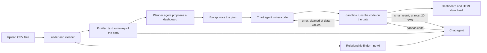

# Agentic Data Analyst

Upload one or more CSV files and get an **AI-planned dashboard** you approve chart by chart, plus a **chat** that answers
questions about your data and shows the calculation behind every number.

**Live demo (free, no sign-up): https://analystiq-agent.streamlit.app**
It opens on a small Formula 1 data set. The saved demo questions and the demo dashboard work without any key.
On the free host, a visitor's own free [Gemini API key](https://aistudio.google.com) lets the chat answer questions about an
uploaded file from its data summary. Live AI dashboards and live calculations on your own data need a host that supports the
sandbox's file-system lock, so for those run the app yourself (see "Run it on your own computer").

Built with Google ADK 2.x (agents), Gemini, pandas, Plotly and Streamlit.

---

## What it does

- **AI dashboard with a human in the loop.** A planner agent proposes charts and KPIs from a text summary of your data.
  You drop what you don't want and approve. A chart agent then writes the code for each chart. If the code fails, the agent
  gets a cleaned-up error message and fixes it itself (up to 3 attempts), then a rule-based chart builder takes over, so a
  dashboard always comes out. The result can be downloaded as a single web page.
- **Chat that shows its work.** The chat agent answers from the data summary. For questions that need real numbers it writes
  pandas code, runs it in a sandbox and answers from the result. Every answer has a "Show the calculation" box with the code and
  the result. Numbers in an answer that appear in neither the summary nor a calculation get a visible warning.
- **Several CSV files at once.** Relationships between files are found without AI (which column of one file points to
  which row of another). Linked lookup tables are joined onto the main table with left joins, so the number of rows never
  changes. The chat can combine tables, and a guard blocks the classic mistake of merging two large event tables and then summing.
- **Everything else you would expect:** automatic data cleaning and profiling, filters in the sidebar that apply to the
  dashboard and the chat, a chart gallery, a "Build a chart" tab, and a Code sandbox tab (local runs only).

## How it works



The agents see a **text summary** of the data (column types, ranges, averages, categories), not the table. Code written by
the AI runs on the real data in a sandbox, and the AI only ever sees a small, size-capped result of that run.

**Built for free-tier limits.** Requests are paced, replies are cached so the same request is never sent twice, and a chain
of three Gemini models takes over when one model's daily quota is used up. A "Replay only" mode answers entirely from saved
replies with no requests at all, which is how the public demo works without a key.

## Evaluation (with the limits stated)

Accuracy is measured against answers computed independently with plain pandas on the same data.

| Test | Questions | Result |
|---|---|---|
| Formula 1, all 14 tables (1950 onwards), several tables per question | 18 | 16/18 on the first run, 17/18 after one fix, **18/18** after a second fix |
| Formula 1 demo subset (2021 and 2022), answered from saved replies | 11 | **11/11**, 0 requests to Google on replay |

How to read these numbers honestly:
- **The 18/18 is not a blind test.** The two misses on the first run were a question that counted result rows instead of
  distinct races and a filter that compared a number column with quoted text. I changed the chat's rules and added a check
  that blocks the second mistake before it runs, then re-ran the same 18 questions. The fix is real, but the score is on
  questions I had already seen. A fresh, unseen question set is the right next test.
- **The checker is automatic.** It compares numbers and names in the answer with the expected ones, so it has limits.
  It can mark a correct answer wrong if it is phrased unusually, and it cannot judge explanations.
- **The demo set is small and its questions are the ones the demo shows.** 11/11 there says the recorded answers are right
  and replay works, not that the AI is 100% accurate.

Run them yourself (needs your Gemini key, see below):
```
python scripts/eval_f1.py "<folder with the 14 Formula 1 csv files>"     # the 18-question test
python scripts/eval_f1.py --demo                                          # the 11-question demo test
python scripts/eval_chat.py                                               # a 30-question test on a single table
```
Reports are written to `eval_results/`.

## Safety and privacy

- **Your data stays in memory for the session.** The hosted demo does not store uploads. It says so in a banner and asks
  you not to upload confidential data. On the free Gemini tier Google may use prompts to improve its products.
- **Bring your own key.** On the public site your key lives only in your browser session. It is not saved, logged, shared
  with other visitors, or kept in the environment, and "Forget my key" erases it.
- **AI-written code runs in a sandbox:** a separate process, a cleaned environment (no keys), no network, no `open()`, an
  allow-list of imports, a static check of the code before it runs, time and memory limits, and a file-system lock
  (Linux Landlock) where the host supports it.
- **This is process-level isolation, not a container.** That is strong enough for a demo with fail-closed checks, but it is
  not the same as running each program in a fresh container.
- **The free host has no file-system lock.** On Streamlit Community Cloud the lock is not available, so the app refuses to
  run any code the AI writes there. The only code that runs on the hosted demo is the saved demo code that was recorded and
  checked on my machine, word for word. With your own key on the hosted site the chat answers from the data summary only, and
  a live "Use AI" dashboard falls back to fixed rules without sending any AI request. For live AI dashboards and live
  calculations, run the app yourself (below).

## Run it on your own computer

You need Python 3.12 or newer and a free Gemini API key from [Google AI Studio](https://aistudio.google.com).

```bash
git clone https://github.com/beingranjithm/data-analyst-agent.git
cd data-analyst-agent
python -m venv .venv
source .venv/bin/activate            # Windows: .venv\Scripts\activate
pip install -r requirements.txt
mkdir -p hello_agent
echo "GOOGLE_API_KEY=your-key-here" > hello_agent/.env      # keep this file out of git
streamlit run app/streamlit_app.py
```

Run the tests (no real AI calls, fake models only):
```bash
pip install pytest
python -m pytest -q
```

To put your own copy online for free, follow [DEPLOY.md](DEPLOY.md).

## Project layout

```
app/streamlit_app.py     the web app (tabs, sidebar, hosted mode)
agents/                  planner, chart agent, self-healing loop, chat agent, multi-table chat,
                         model cache, pacing and the three-model fallback
tools/                   loading, cleaning, profiling, relationship finder, filters, sandbox, hosting rules
ui/                      the dashboard, chat and key panels
evals/ and scripts/      the accuracy tests and helper scripts
tests/                   automated tests
deploy/demo_cache.json   the saved demo answers
sample_data/             a small sales file and the Formula 1 demo set
```

## How it was tested

- **About 780 automated tests** run with fake models and a fake sandbox, so they are fast, free and repeatable.
- **Mutation checks:** for new features I deliberately broke the code in small ways and confirmed the tests noticed, then
  added tests for the ones that slipped through.
- **Real Gemini runs happen only in the evaluations** above and on my own computer, never in the automated tests.
- The sandbox's real behaviour on the free host was checked by deploying and trying it, not by a unit test.

## Known limits

- The 18-question score is not blind (see above).
- The "do not merge two event tables" guard is a rule of thumb on the code text. It stops the common mistake, not every mistake.
- Very wide tables get fewer filters, and big files are slow or refused on the free host (15 MB per file, 30 MB in total).
- The free host goes to sleep when nobody uses it, so the first visit can take a short while.
- Excel files with several sheets are not supported yet. CSV only.

## Data credit

The Formula 1 demo set is a subset (seasons 2021 and 2022) of
[Formula 1 World Championship (1950 - 2024)](https://www.kaggle.com/datasets/rohanrao/formula-1-world-championship-1950-2020)
by Rohan Rao on Kaggle, listed there as **CC0: Public Domain**. The underlying results come from the Ergast F1 database.
See [DATA_LICENSE.md](DATA_LICENSE.md). This project is free and non-commercial.
